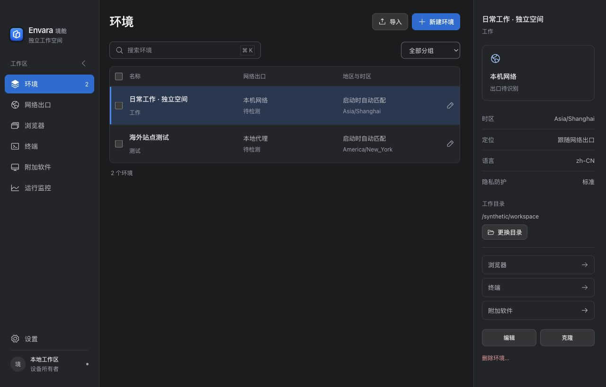

  

<table>
  <tr>
    <td width="50%" valign="top">
      <h3>AI practitioner · Independent creator · Trader</h3>
      
Former cybersecurity engineer, now turning ideas into practical tools with AI.

      
By day, I work at a large state-owned enterprise in China. Beyond work, I build independently, explore infrastructure for taking products global, and trade stocks, commodities &amp; crypto.

      
<em>Security roots. A builder's mindset. Global horizons.</em>

    </td>
    <td width="50%" valign="top">
      <h3>AI 实践者 · 独立创作者 · 交易者</h3>
      
曾是网络安全工程师，如今用 AI 把想法变成实用工具。

      
本职在国内一家大型国企。工作之外，独立创作、探索产品出海所需的基础设施，也交易股票、大宗商品与加密货币。

      
<em>安全的底色，创造的心态，全球的视野。</em>

    </td>
  </tr>
</table>

## Building Envara · 持续构建境舱

### [Envara · 境舱](https://github.com/ink-scholar/Envara)

**One environment. Your browser, terminal and apps.** 
**给每一套工作，一个独立的境舱。**

An open-source desktop workspace for browsers, terminals and supported apps. Keep network settings, browsing data and tool configurations organized by environment, and pick up where you left off.

开源的本地桌面工作区，将浏览器、终端和受支持的桌面应用放在同一环境中，分别保存网络、浏览资料与工具配置。切换项目，接着上次的工作继续。

  
   
  Current workspace with demonstration data · 新版工作区，使用合成示例数据

- **Browsers & networks · 浏览器与网络** — Persistent browser profiles and network settings for each environment. 独立浏览资料、持久身份与各自的网络配置。
- **Terminals & AI · 终端与 AI** — Saved terminal entries, Claude Code, MCP and saved SSH connections. 保存常用终端，连接 AI 工具与远程主机。
- **Supported apps · 附加应用** — Bring supported desktop apps into the workspace with separate application data. 为受支持的桌面应用保存独立资料，在环境中管理启动与停止。

**Open source · 9 interface languages · macOS Apple Silicon downloads** 
**开源 · 九种界面语言 · 提供 macOS Apple Silicon 安装包**

[Explore · 项目主页](https://github.com/ink-scholar/Envara) · [Download · 最新版本](https://github.com/ink-scholar/Envara/releases/latest) · [Guide · 使用指南](https://github.com/ink-scholar/Envara/blob/main/docs/user-guide.md) · [Feedback · 反馈](https://github.com/ink-scholar/Envara/issues)

<em>In the age of AI, the only limit is your imagination.</em> AI 时代，只有想不到，没有做不到。

