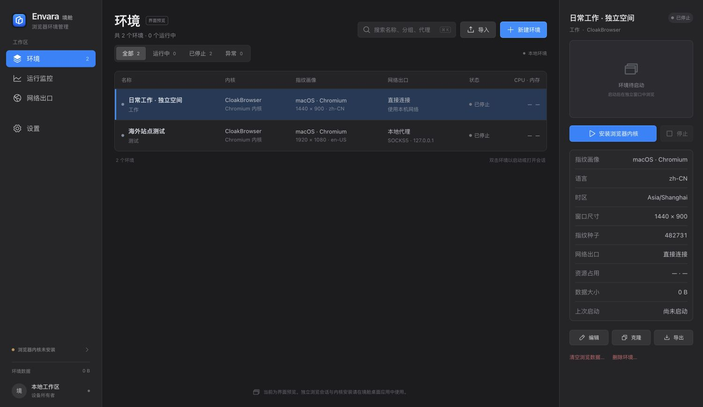

  

<table>
  <tr>
    <td width="50%" valign="top">
      <h3>AI practitioner · Independent creator · Trader</h3>
      
Former cybersecurity engineer, now turning ideas into practical tools with AI.

      
By day, I work at a large state-owned enterprise in China. Beyond work, I build independently, explore infrastructure for taking products global, and trade stocks, commodities &amp; crypto.

      
<em>Security roots. A builder's mindset. Global horizons.</em>

    </td>
    <td width="50%" valign="top">
      <h3>AI 实践者 · 独立创作者 · 交易者</h3>
      
曾是网络安全工程师，如今用 AI 把想法变成实用工具。

      
本职在国内一家大型国企。工作之外，独立创作、探索产品出海所需的基础设施，也交易股票、大宗商品与加密货币。

      
<em>安全的底色，创造的心态，全球的视野。</em>

    </td>
  </tr>
</table>

### Featured build · 正在创造

<table>
  <tr>
    <td width="36%">
      
    </td>
    <td width="64%" valign="middle">
      <h3><a href="https://github.com/ink-scholar/Envara">Envara · 境舱</a></h3>
      
Isolated, persistent browser environments in one desktop workspace.

      
一个中文优先的浏览器环境桌面管理器，让浏览数据、指纹配置和代理各归其位。

      
<strong>Open source · Alpha</strong> &nbsp; / &nbsp; 开源 · 持续打磨

      
<a href="https://github.com/ink-scholar/Envara">Explore Envara</a> · <a href="https://github.com/ink-scholar/Envara/releases">Download</a> · <a href="https://github.com/ink-scholar/Envara/issues">Feedback</a>

    </td>
  </tr>
</table>

<em>In the age of AI, the only limit is your imagination.</em> AI 时代，只有想不到，没有做不到。

